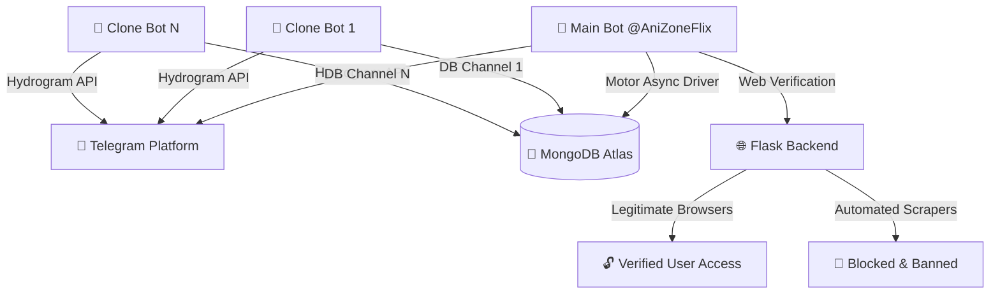

<p align="center">
  <a href="#!">
    
  </a>
</p>

<h1 align="center">🤖 AniZoneFlix Telegram File Store Bot</h1>

<p align="center">
  <b>A fast, secure, and modern Telegram File Storage system built with Python, Hydrogram (Layer 223), Flask, and MongoDB. Supports multi-channel storage, clone bots, URL shorteners, browser verification, auto-batching, and premium subscriptions.</b>
</p>

<p align="center">
  <a href="#!"></a>
  <a href="#!"></a>
  <a href="#!"></a>
  <a href="#!"></a>
</p>

<hr style="border: 0; height: 1px; background: linear-gradient(to right, rgba(255,255,255,0), rgba(255,255,255,0.15), rgba(255,255,255,0)); margin: 30px 0;" />

## 🌟 Key Features

* **📦 Unlimited File Storage & Retrieval**
  Store files in private database channels and share them via single-file or batch share links.
* **🤖 Clone Bot Network**
  Deploy multiple clone bots linked to the main database with individual database channel configurations.
* **⚡ Advanced Auto-Batching (`/advbatch`)**
  Scan channel ranges, filter files by name, automatically group by quality (480P, 720P, 1080P, 4K), and generate shareable links.
* **🛡️ Shortener & Web Verification Flow**
  Monetize content by routing unverified users through shortlink providers and browser verification pages.
* **🚫 Bot & Scraper Protection**
  Allows legitimate user browsers (Chrome, Safari, Firefox, Edge, Opera) while detecting and blocking automated scrapers, headless tools, and bypass bots.
* **💎 Premium User Access**
  Grant premium access (`/addpremium`) to allow users to bypass shortener verification completely.
* **🎨 Custom Styled Buttons**
  All inline buttons use native Hydrogram button styling (`style="primary"`, `style="success"`, `style="danger"`) for a clean, premium user interface.
* **📊 Analytics & Reports**
  Detailed `/count` and `/stats` reporting with date filter support and active vs. expired verification statistics.

<hr style="border: 0; height: 1px; background: linear-gradient(to right, rgba(255,255,255,0), rgba(255,255,255,0.15), rgba(255,255,255,0)); margin: 30px 0;" />

## 📡 Architecture Diagram



<hr style="border: 0; height: 1px; background: linear-gradient(to right, rgba(255,255,255,0), rgba(255,255,255,0.15), rgba(255,255,255,0)); margin: 30px 0;" />

## 📜 Command Reference

### 👤 User Commands
* `/start` — Start the bot or retrieve files via share links.
* `/help` — Open the interactive command directory.
* `/ping` — Check bot response latency.
* `/verify` — Check or extend your shortener verification access.

### 👑 Admin & Control Commands
* `/panel` — Open the central master admin control panel.
* `/advbatch` / `/auto_batch` — Run the advanced quality-segregated batch scanner.
* `/batch` — Create a batch link from a message ID range.
* `/genlink` — Generate a share link for a single channel post.
* `/count [date|today|yesterday]` — View detailed report of verified users with filter support.
* `/add_admin <user_id>` / `/deladmin <user_id>` — Manage bot admin permissions.
* `/addshortener <domain> <api_key>` / `/delshortener` — Manage shortener configurations.
* `/addpremium <user_id|@username> <duration>` — Grant premium status to users.
* `/delpremium <user_id|@username>` — Revoke premium access.
* `/premium_users` — List active premium users.
* `/addclone <username> <token> <db_channel_id>` — Register a clone bot instance.
* `/delclone <username>` / `/clones` — Manage active clone bots.
* `/broadcast` / `/pbroadcast` / `/dbroadcast` — Send broadcasts to all registered users.
* `/stats` — Display system RAM, CPU, total user count, and uptime.
* `/restart` — Reload and restart the bot engine.

<hr style="border: 0; height: 1px; background: linear-gradient(to right, rgba(255,255,255,0), rgba(255,255,255,0.15), rgba(255,255,255,0)); margin: 30px 0;" />

## ⚙️ Environment Variables

| Variable | Required | Description |
| :--- | :---: | :--- |
| `APP_ID` | **Yes** | Your Telegram API ID from my.telegram.org |
| `API_HASH` | **Yes** | Your Telegram API Hash from my.telegram.org |
| `TG_BOT_TOKEN` | **Yes** | Main Bot Token from @BotFather |
| `DATABASE_URL` | **Yes** | MongoDB Connection URI string |
| `CHANNEL_ID` | **Yes** | Primary DB Channel ID (e.g., `-1001234567890`) |
| `OWNER_ID` | **Yes** | Telegram User ID of the Bot Owner |
| `PORT` | No | Port for the Flask web server (Default: `8080` / `8001`) |

<hr style="border: 0; height: 1px; background: linear-gradient(to right, rgba(255,255,255,0), rgba(255,255,255,0.15), rgba(255,255,255,0)); margin: 30px 0;" />

## 🚀 Local & VPS Setup Guide

```bash
# 1. Clone the repository
git clone https://github.com/anizoneflix/Telegram-File-Store.git
cd Telegram-File-Store

# 2. Install dependencies
pip install -r requirements.txt

# 3. Set environment variables or create .env file
cp .env.sample .env  # Optional: fill in variables in .env

# 4. Run test suite
python3 -m unittest discover -s . -p "test_*.py"

# 5. Start the bot system
python3 main.py
```

<hr style="border: 0; height: 1px; background: linear-gradient(to right, rgba(255,255,255,0), rgba(255,255,255,0.15), rgba(255,255,255,0)); margin: 30px 0;" />

## ⭐️ Credits
Maintained with ❤️ by **[AniZoneFlix](https://t.me/anizoneflix)**.
