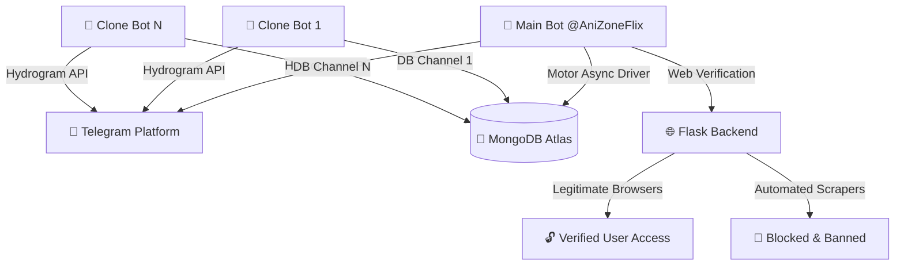

<p align="center">
  <a href="#!">
    
  </a>
</p>

<h1 align="center">🤖 AniZoneFlix Telegram File Store Bot</h1>

<p align="center">
  <b>An ultra-fast, fully optimized, high-performance Telegram File Storage & Distribution system built with Python, Hydrogram (Layer 223), Flask, Motor Async, and MongoDB. Supports multi-channel storage, clone bot networks, URL shorteners, anti-bypass browser verification, advanced quality auto-batching with multi-range episode selection, and premium subscriptions.</b>
</p>

<p align="center">
  <a href="#!"></a>
  <a href="#!"></a>
  <a href="#!"></a>
  <a href="#!"></a>
</p>

<hr style="border: 0; height: 1px; background: linear-gradient(to right, rgba(255,255,255,0), rgba(255,255,255,0.15), rgba(255,255,255,0)); margin: 30px 0;" />

## 🌟 Key Features

* **⚡ Ultra-Fast Performance & In-Memory Caching Engine**
  High-frequency database queries (admins, banned users, config settings, auto-delete timer, force-sub channels) are cached in memory to deliver instantaneous bot response speeds with zero MongoDB network bottlenecks.

* **📦 Unlimited File Storage & Retrieval**
  Store files in private database channels and share them seamlessly via protected single-file or batch share links.

* **🎬 Advanced Auto-Batching with Range Input Support (`/advbatch` & `/auto_batch`)**
  Scan database channel post ranges, filter files by anime title across filenames and captions, automatically segregate by quality (480P, 720P, 1080P, 4K), and generate protected links. Supports single count (`32`), single episode range (`1-32`), and multi-range count inputs (`1-32,33-62`).

* **📜 Interactive Paginated Help Menu (`/help`)**
  Smooth, fully functional interactive help directory with prev/next page navigation buttons, command descriptions, usages, and examples.

* **🤖 Multi-Bot Clone Network**
  Deploy and manage multiple clone bots connected to custom database channels. All clones inherit main bot features while operating independently.

* **🛡️ Shortener & Web Verification System**
  Route unverified users through shortlink providers and browser verification pages before unlocking file access.

* **🚫 Anti-Bypass & Scraper Protection**
  Verifies legitimate web browsers (Chrome, Safari, Firefox, Edge, Opera) while detecting and auto-banning automated bypass bots, scrapers, and headless tools.

* **💎 Premium User Access & Downtime Compensation**
  Grant premium access (`/addpremium`) to allow users to bypass shorteners completely. Automatically compensates active verified and premium durations after system downtime.

* **🎨 Custom Styled Native Buttons**
  All inline buttons utilize native Hydrogram button styling (`style="primary"`, `style="success"`, `style="danger"`) for a clean, premium user interface.

<hr style="border: 0; height: 1px; background: linear-gradient(to right, rgba(255,255,255,0), rgba(255,255,255,0.15), rgba(255,255,255,0)); margin: 30px 0;" />

## 📡 System Architecture



<hr style="border: 0; height: 1px; background: linear-gradient(to right, rgba(255,255,255,0), rgba(255,255,255,0.15), rgba(255,255,255,0)); margin: 30px 0;" />

## 🎯 Range Input Support in `/advbatch` & `/auto_batch`

When running `/advbatch` or `/auto_batch`, the Step 1 wizard prompts for the episode count or ranges to process:

### Supported Input Formats
* **Single Count:** `32` *(Processes episodes 1 to 32)*
* **Single Range:** `1-32` *(Processes episodes 1 to 32)*
* **Multiple Ranges:** `1-32,33-62` *(Generates separate batch links for episodes 1–32 and episodes 33–62)*
* **Multi-Chunk Ranges:** `1-12, 13-24, 25-50`
* **All Available:** `all` or `auto` *(Processes all matching episodes found)*

### Example Output
```html
🎬 Quality: 1080P (Episodes 1-32)
First Filename: [AniZoneFlix] Naruto - S01E01.mkv
First Caption: Naruto Episode 01 [1080p]
Last Filename: [AniZoneFlix] Naruto - S01E32.mkv
Last Caption: Naruto Episode 32 [1080p]

Link: https://telegram.me/AniZoneFlixBot?start=get-...

🎬 Quality: 1080P (Episodes 33-62)
First Filename: [AniZoneFlix] Naruto - S01E33.mkv
First Caption: Naruto Episode 33 [1080p]
Last Filename: [AniZoneFlix] Naruto - S01E62.mkv
Last Caption: Naruto Episode 62 [1080p]

Link: https://telegram.me/AniZoneFlixBot?start=get-...
```

<hr style="border: 0; height: 1px; background: linear-gradient(to right, rgba(255,255,255,0), rgba(255,255,255,0.15), rgba(255,255,255,0)); margin: 30px 0;" />

## 📜 Command Reference

### 👤 User Commands
* `/start [payload]` — Start or restart the bot, or retrieve files via deep link.
* `/help` — Open the interactive paginated command directory.
* `/ping` — Check bot response latency.
* `/verify` — Check or extend active shortener verification status.

### 👑 Admin & Control Commands
* `/panel` — Open the central master admin control panel.
* `/advbatch` / `/auto_batch` — Run the advanced quality-segregated batch scanner with multi-range support.
* `/serialbatch` — Generate serial batch links for media matching a filter name.
* `/batch` — Create a batch share link from message ID range.
* `/genlink` — Generate a single share link for a DB post.
* `/custom_batch` — Save manually sent messages directly into a batch share link.
* `/count [today|yesterday|date]` — View detailed report of verified users with filter support.
* `/add_admin <user_id>` / `/deladmin <user_id>` / `/admins` — Manage bot admin permissions.
* `/addshortener <domain> <api_key>` / `/delshortener` / `/shorteners` — Manage shortener configurations.
* `/addpremium <user_id|@username> <duration>` — Grant premium status to users.
* `/delpremium <user_id|@username>` / `/premium_users` — Manage premium user access.
* `/addclone <username> <token> <db_channel_id>` / `/delclone <username>` / `/clones` — Manage active clone bots.
* `/add_db_channel <channel_id>` / `/del_db_channel` / `/list_db_channels` — Manage secondary database channels.
* `/addchnl <channel_id>` / `/delchnl` / `/listchnl` / `/fsub_mode` — Manage force subscription channels.
* `/broadcast` / `/pbroadcast` / `/dbroadcast` — Send broadcasts to registered users.
* `/delete <message_id|range|link>` — Delete messages directly from DB channels.
* `/dlt_time <seconds>` / `/check_dlt_time` — Configure auto-delete duration for shared files.
* `/retrieve_on` / `/retrieve_off` — Toggle file deletion alert and "Get File Again" button.
* `/verify_on` / `/verify_off` — Toggle global shortener verification requirement.
* `/set_base_url <url>` — Update verification website domain URL.
* `/hyperlink` — Extract hyperlinks from sent or forwarded messages.
* `/stats` — Display system RAM, CPU, total user count, and uptime.
* `/restart` — Reload and restart the bot engine.

<hr style="border: 0; height: 1px; background: linear-gradient(to right, rgba(255,255,255,0), rgba(255,255,255,0.15), rgba(255,255,255,0)); margin: 30px 0;" />

## ⚙️ Environment Variables

| Variable | Required | Description |
| :--- | :---: | :--- |
| `APP_ID` | **Yes** | Telegram API ID from [my.telegram.org](https://my.telegram.org) |
| `API_HASH` | **Yes** | Telegram API Hash from [my.telegram.org](https://my.telegram.org) |
| `TG_BOT_TOKEN` | **Yes** | Main Bot Token from [@BotFather](https://t.me/BotFather) |
| `DATABASE_URL` | **Yes** | MongoDB Connection URI string |
| `CHANNEL_ID` | **Yes** | Primary DB Channel ID (e.g. `-1001234567890`) |
| `OWNER_ID` | **Yes** | Telegram User ID of the Bot Owner |
| `PORT` | No | Port for Flask web server (Default: `8080`) |
| `TG_BOT_WORKERS` | No | Hydrogram background worker threads (Default: `200`) |

<hr style="border: 0; height: 1px; background: linear-gradient(to right, rgba(255,255,255,0), rgba(255,255,255,0.15), rgba(255,255,255,0)); margin: 30px 0;" />

## 🚀 Local & VPS Setup Guide

```bash
# 1. Clone the repository
git clone https://github.com/anizoneflix/Telegram-File-Store.git
cd Telegram-File-Store

# 2. Install dependencies
pip install -r requirements.txt

# 3. Create .env file with your credentials
cp .env.sample .env

# 4. Run test suite
python3 -m unittest discover -s . -p "test_*.py"

# 5. Start the bot system
python3 main.py
```

<hr style="border: 0; height: 1px; background: linear-gradient(to right, rgba(255,255,255,0), rgba(255,255,255,0.15), rgba(255,255,255,0)); margin: 30px 0;" />

## ⭐️ Credits
Maintained with ❤️ by **[AniZoneFlix](https://t.me/anizoneflix)**.
