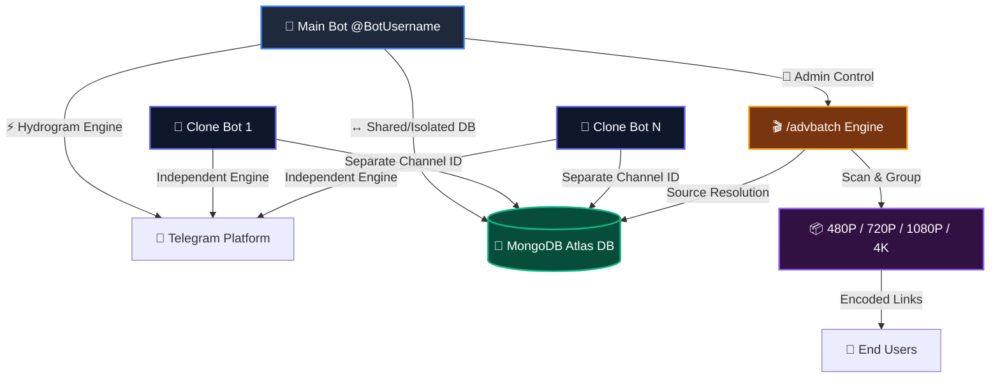

<p align="center">
  <a href="#!">
    
  </a>
</p>

<h1 align="center">🤖 Telegram File Store Bot (Multi-Bot & Auto-Batch Engine)</h1>

<p align="center">
  <b>A hyper-fast, secure, and modern Telegram File Storage engine built on Hydrogram framework (API Layer 223). Supports main bot & clone bot instances, multi-channel storage, dynamic shortener verification, automated downtime compensation, premium user tiers, and advanced batching.</b>
</p>

<p align="center">
  <a href="#!"></a>
  <a href="#!"></a>
  <a href="#!"></a>
  <a href="#!"></a>
</p>

<hr style="border: 0; height: 1px; background: linear-gradient(to right, rgba(255,255,255,0), rgba(255,255,255,0.15), rgba(255,255,255,0)); margin: 30px 0;" />

## 📡 Multi-Bot & Database Architecture



<hr style="border: 0; height: 1px; background: linear-gradient(to right, rgba(255,255,255,0), rgba(255,255,255,0.15), rgba(255,255,255,0)); margin: 30px 0;" />

## ⚡ Core Features

*   **🎬 Advanced Auto-Batching (`/advbatch` & `/auto_batch`)**
    Scans channel ranges, automatically parses Season/Episode/Part metadata, filters by anime title, groups files by quality (480P, 720P, 1080P, 4K), and generates encoded batch links with progress tracking bars.
*   **🤖 Main & Clone Bot Ecosystem**
    Run infinite clone bots alongside the main bot. Each clone bot operates with its own designated database channel ID while using isolated task queues and state management.
*   **🔀 Dual Range Link Format Support**
    Full support for all range link variations across both main and clone bots:
    - **Format A:** `https://t.me/c/CHANNEL_ID/START-https://t.me/c/CHANNEL_ID/END`
    - **Format B:** `https://t.me/c/CHANNEL_ID/START-END`
*   **🛡️ Shortener Verification System**
    Redirects unverified users through configured shortlink services. Includes configurable expiration durations (`/set_verify_expire`) and session tokens (`/verify`).
*   **💎 Premium Tier Management**
    Grant premium subscriptions (`/addpremium`, `/delpremium`, `/premium_users`) to allow instant access bypassing all shortener verification steps.
*   **⏱ Automatic Downtime Compensation**
    Background heartbeats monitor bot downtime during system updates or restarts and automatically grant time extension compensation to active verified and premium users.
*   **🎨 Custom Styled Buttons**
    Supports button styling natively via Hydrogram (`style="primary"`, `style="danger"`, `style="success"`) and attachable dynamic custom buttons across all delivered content.

<hr style="border: 0; height: 1px; background: linear-gradient(to right, rgba(255,255,255,0), rgba(255,255,255,0.15), rgba(255,255,255,0)); margin: 30px 0;" />

## 🛠 Usage Guide for `/advbatch`

The `/advbatch` command allows authorized administrators to automatically scan message ranges, filter videos/documents by title, organize them into quality tiers, and generate shareable batch links.

### Supported Input Range Link Formats
1. **Format A (Full Double URL):**
   ```text
   https://t.me/c/1234567890/100-https://t.me/c/1234567890/200
   ```
2. **Format B (Range Short-Form):**
   ```text
   https://t.me/c/1234567890/100-200
   ```
3. **Multi-Line Multi-Range Input:**
   ```text
   https://t.me/c/1234567890/100-200
   https://t.me/c/9876543210/500-https://t.me/c/9876543210/600
   ```

### Execution Steps
1. Send `/advbatch` or `/auto_batch` to the bot.
2. Reply with the channel range link(s) or send them when prompted.
3. **Step 1/2:** Specify total file count (e.g. `12`, `24`) or send `all`.
4. **Step 2/2:** Send the search title filter (e.g. `Naruto`) or send `.` for no title filter.
5. Review the batch summary and click **🚀 Start All**.

<hr style="border: 0; height: 1px; background: linear-gradient(to right, rgba(255,255,255,0), rgba(255,255,255,0.15), rgba(255,255,255,0)); margin: 30px 0;" />

## 🛠 Commands Deck

<details>
<summary><b>👤 User Commands</b></summary>
<br>

*   `/start` — Initialize bot interface or retrieve shared file payloads.
*   `/help` — Show help and support information.
*   `/ping` — Check bot response latency.
*   `/verify` — Check verification status or generate a shortlink to extend access.

</details>

<details>
<summary><b>👑 Admin & Control Panel Commands</b></summary>
<br>

### 🎬 Auto-Batch & Link Generation
*   `/advbatch` or `/advance_batch` — Execute advanced quality-segregated auto-batch scanner.
*   `/auto_batch` — Execute standard auto-batch scanner across quality tiers.
*   `/cancel_batch` — Cancel running or queued auto-batch tasks.
*   `/batch` — Manually create a batch link from start to end message IDs.
*   `/genlink` — Generate a shareable link for a single channel post.
*   `/custom_batch` — Collect arbitrary messages interactively into a single batch link.

### 🤖 Clone Bot & DB Management
*   `/addclone <username> <token> <db_channel_id>` — Register a new clone bot with its own DB channel.
*   `/delclone <username>` — Remove an active clone bot.
*   `/clones` — List all registered clone bots and status.
*   `/add_db_channel <channel_id>` — Add a secondary database storage channel.
*   `/del_db_channel <channel_id>` — Remove a secondary database channel.
*   `/list_db_channels` — List all configured secondary database channels.

### 🛡️ Verification & Shorteners
*   `/verify_on` — Enable mandatory shortener verification.
*   `/verify_off` — Disable shortener verification.
*   `/set_verify_expire <duration>` — Set verified access expiration (e.g., `24h`, `12h`, `86400`).
*   `/addshortener <domain> <api_key>` — Register a new shortener service.
*   `/delshortener` — Remove an active shortener service.
*   `/shorteners` — View configured shorteners.
*   `/reset <all|user_id>` — Reset active user verification access instantly.
*   `/count [date]` — View report of verified users.

### 💎 Premium Management
*   `/addpremium <user_id|@username> <duration>` — Grant premium status (e.g., `7 days`, `1 month`).
*   `/delpremium <user_id|@username>` — Revoke premium status.
*   `/premium_users` — List active premium subscribers.

### ⚙️ System Controls
*   `/panel` — Open interactive central control panel.
*   `/broadcast` / `/pbroadcast` / `/dbroadcast` — Send global text, photo, or document broadcasts.
*   `/stats` — View system CPU, RAM, total user count, and clone bot metrics.
*   `/restart` — Restart the bot engine.

</details>

<hr style="border: 0; height: 1px; background: linear-gradient(to right, rgba(255,255,255,0), rgba(255,255,255,0.15), rgba(255,255,255,0)); margin: 30px 0;" />

## ⚙️ Environment Configuration

| Variable | Type | Description | Required |
| :--- | :--- | :--- | :--- |
| `APP_ID` | Integer | Telegram API ID from my.telegram.org. | **Yes** |
| `API_HASH` | String | Telegram API Hash from my.telegram.org. | **Yes** |
| `TG_BOT_TOKEN` | String | Main Bot Token from @BotFather. | **Yes** |
| `DATABASE_URL` | Connection String | MongoDB connection URI string. | **Yes** |
| `DATABASE_NAME` | String | MongoDB database name (Default: `Cluster0`). | No |
| `CHANNEL_ID` | Integer | Primary database channel ID (e.g. `-1001234567890`). | **Yes** |
| `OWNER_ID` | Integer | Telegram User ID of the bot owner. | **Yes** |

<hr style="border: 0; height: 1px; background: linear-gradient(to right, rgba(255,255,255,0), rgba(255,255,255,0.15), rgba(255,255,255,0)); margin: 30px 0;" />

## 🚀 Deployment Instructions

### Local / VPS Setup

```bash
# Clone the repository
git clone https://github.com/anizoneflix/Telegram-File-Store.git
cd telegram-file-store

# Install Python dependencies
pip3 install -r requirements.txt

# Run unit test suite
python3 -m unittest discover -s . -p "test_*.py"

# Start the bot engine
python3 main.py
```

<hr style="border: 0; height: 1px; background: linear-gradient(to right, rgba(255,255,255,0), rgba(255,255,255,0.15), rgba(255,255,255,0)); margin: 30px 0;" />

## ⭐️ Credits & Support
Maintained with ❤️ by **[@anizoneflix](https://t.me/anizoneflix)**.
Join our official channel for updates, open-source projects, and support!
